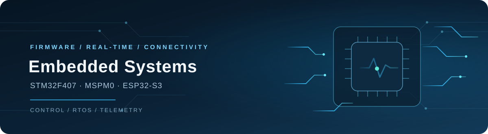

  

<h1 align="center">mamorrozer</h1>

  <strong>嵌入式软件 · 实时系统 · MCU 控制与通信</strong> 
  从外设驱动、任务调度到设备联网，持续做可运行、可验证的工程项目。

  <a href="https://github.com/mamorrozer/f407-freertos-esp32-telemetry">查看 FreeRTOS 双 MCU 遥测终端</a>

  
  
  
  
  
  

## 代表项目

### STM32F407 + FreeRTOS 环境遥测终端

基于 STM32F407 与 ESP32-S3 的双 MCU 项目：F407 采集 BMP280 / AHT20、刷新 TFT 并通过 UART 发送遥测；ESP32-S3 负责 Wi-Fi 和 MQTT。项目包含任务与队列划分、文本/二进制协议、CRC16、有限 RAM 缓存、断线恢复，以及 CMake / CTest 主机测试。

[查看源码、架构与验证记录 →](https://github.com/mamorrozer/f407-freertos-esp32-telemetry)

  

### MSPM0 H 题车载平衡滚球系统

2026 年全国大学生电子设计竞赛广东赛区省级三等奖团队项目。我主导 MSPM0 主控软件和系统集成，涉及八路循迹、K230 钢球视觉、步进摆杆、状态机与安全停车。精选仓库说明实测边界，并展示代表性算法模块；不包含完整烧录工程。

[查看架构、验证记录与精选源码 →](https://github.com/mamorrozer/mspm0-h-contest-showcase)

### K230 钢球视觉部署与控制侧准备

从车载系统中拆出视觉子系统，单独记录固定输入尺寸 YOLO、K230 板端速度对比、目标框筛选、管道轴线投影、位置/速度平滑，以及向主控发送诊断数据前的校准边界。352×192 版本在本地 LCD 测试中约 28 FPS，512×288 版本约 20 FPS；ROI 版本因板端零检出被保留为失败对照，不作为完成指标。

[查看视觉部署、测量记录与控制交接 →](https://github.com/mamorrozer/k230-steel-ball-vision)

  

## 技术方向

| 方向 | 项目中使用的技术 |
|---|---|
| MCU 与固件 | C、STM32F407、TI MSPM0G3507、ESP32-S3 |
| 视觉与部署 | Python、YOLO、K230/CanMV、固定输入尺寸、坐标投影 |
| 实时系统 | FreeRTOS 任务、周期调度、队列、运行状态观测 |
| 外设与通信 | UART、I²C、SPI、CRC16、MQTT |
| 构建与验证 | ESP-IDF、CMake、CTest、串口日志与双板联调 |

## 竞赛经历

- 2026 年全国大学生电子设计竞赛广东赛区省级三等奖。
- 第二十一届“信息杯”社会调研比赛二等奖（团队赛，2025 年 12 月）。

## 项目记录

我会在仓库中记录设计取舍、验证范围和未覆盖的情况。项目中的独立模块、主机测试结果与实机验证会分开说明；技术栈按实际项目使用经历列出。
